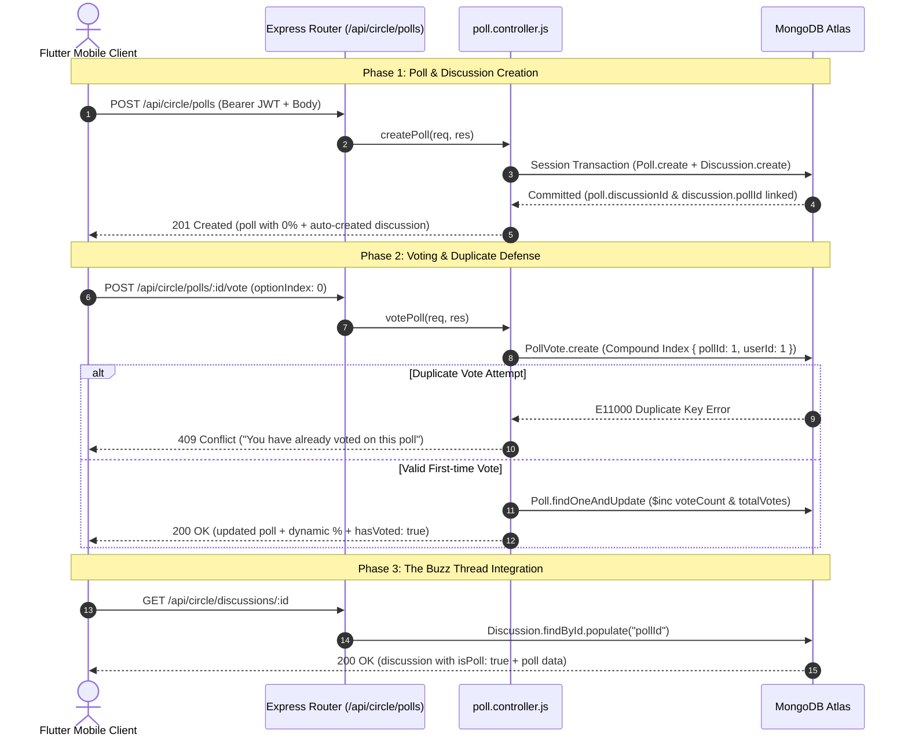

# Community Polls, Voting & The Buzz Discussion Integration

**Module:** Bummps Circle / Community Polls  
**Version:** 1.0.0 (Production-Ready)  
**Base URL:** `https://datingapp-oz22.onrender.com/api/circle/polls`  

---

## 1. System Overview & Architecture

The **Community Polls** module allows Bummps dating app users to create interactive polls across relationship and dating lifestyle categories. 

Every poll created automatically provisions a linked discussion thread in **The Buzz** (`CircleDiscussion`), bridging immediate voting interactions with deep community discussion.

### Core Workflow Diagram



---

## 2. Database Models & Indexing

### A. `Poll` (`models/poll.model.js`)
* **Collection:** `polls`
* **Schema Highlights:**
  * `createdBy`: Reference to `User` (`ObjectId`, required, indexed).
  * `question`: String (required, trimmed, max 250 characters).
  * `category`: String enum:
    `['DATING VIBE', 'FIRST MOVES', 'GREEN FLAGS', 'RED FLAGS', 'TRAVEL & ESCAPES', 'NIGHTLIFE', 'DATING ETIQUETTE', 'WEEKEND RHYTHM', 'UNFILTERED']`.
  * `options`: Subdocument array (validated: 2 to 4 options).
    * `optionIndex`: Number (sequential, starting at 0).
    * `optionText`: String (max 100 characters).
    * `voteCount`: Number (default: 0, non-negative).
  * `totalVotes`: Number (default: 0, non-negative).
  * `discussionId`: Reference to `Discussion` (`ObjectId`, default: null).
  * `expiresAt`: Date (default: 7 days from creation).
  * `status`: String enum (`'active'`, `'closed'`, default: `'active'`).
* **Compound Index:** `{ status: 1, createdAt: -1 }` for high-performance feed filtering and sorting.

### B. `PollVote` (`models/pollVote.model.js`)
* **Collection:** `pollvotes`
* **Schema Highlights:**
  * `pollId`: Reference to `Poll` (`ObjectId`, required).
  * `userId`: Reference to `User` (`ObjectId`, required).
  * `optionIndex`: Number (required).
* **Critical Engine-Level Index:**
  ```javascript
  pollVoteSchema.index({ pollId: 1, userId: 1 }, { unique: true });
  ```
  Guarantees that a user can never cast multiple votes on the same poll, even under simultaneous/race conditions.

### C. `Discussion` Additive Fields (`models/discussion.model.js`)
* `pollId`: Reference to `Poll` (`ObjectId`, default: null).
* `isPoll`: Boolean (default: false).
* Registered `"CircleDiscussion"` alias for seamless cross-spec model resolution.

---

## 3. Dynamic Percentage Calculation Engine

Percentages are **never stored** in MongoDB to avoid stale state and race condition drift. Instead, they are computed dynamically:

$$\text{percentage} = \text{totalVotes} > 0 \ ? \ \text{Number}\left(\left(\frac{\text{option.voteCount}}{\text{totalVotes}} \times 100\right).\text{toFixed}(1)\right) : 0.0$$

* When `totalVotes === 0`, all options return `0.0`.
* Percentages are rounded to **1 decimal place** as numeric values (`float`), not strings (e.g. `63.8`, not `"63.8%"`).

---

## 4. REST API Endpoint Specifications

All endpoints require JWT Bearer Authentication (`Authorization: Bearer <token>`).

---

### 4.1 Create Poll (and Auto-create Buzz Discussion)
Creates a new poll and automatically provisions a matching discussion thread in "The Buzz".

* **Endpoint:** `POST /api/circle/polls`
* **Auth:** Required (`protect`)
* **Headers:** `Content-Type: application/json`

#### Request Body
```json
{
  "question": "First Date Vibe: Speakeasy Cocktails or Candlelit Rooftop?",
  "category": "DATING VIBE",
  "options": [
    "🍸 Speakeasy Cocktails",
    "🕯️ Candlelit Rooftop"
  ],
  "durationDays": 7
}
```

#### Success Response (`201 Created`)
```json
{
  "success": true,
  "message": "Poll and discussion created successfully",
  "data": {
    "poll": {
      "_id": "6741ee8490a1bc2345678901",
      "question": "First Date Vibe: Speakeasy Cocktails or Candlelit Rooftop?",
      "category": "DATING VIBE",
      "options": [
        { "optionIndex": 0, "optionText": "🍸 Speakeasy Cocktails", "voteCount": 0, "percentage": 0.0 },
        { "optionIndex": 1, "optionText": "🕯️ Candlelit Rooftop", "voteCount": 0, "percentage": 0.0 }
      ],
      "totalVotes": 0,
      "hasVoted": false,
      "userSelectedOptionIndex": null,
      "discussionId": "6741ee8490a1bc2345678902",
      "status": "active",
      "expiresAt": "2026-11-30T12:00:00.000Z",
      "createdAt": "2026-11-23T12:00:00.000Z"
    },
    "discussion": {
      "_id": "6741ee8490a1bc2345678902",
      "title": "First Date Vibe: Speakeasy Cocktails or Candlelit Rooftop?",
      "subtitle": "Cast your vote in the community poll and share your thoughts below!",
      "category": "DATING VIBE",
      "repliesCount": 0,
      "pollId": "6741ee8490a1bc2345678901",
      "isPoll": true
    }
  }
}
```

---

### 4.2 Get Community Polls Feed
Fetches active polls for the Community Tab with live percentages, user voting state, and pagination.

* **Endpoint:** `GET /api/circle/polls`
* **Auth:** Required (`protect`)
* **Query Parameters:**
  * `page` (integer, default: 1)
  * `limit` (integer, default: 10, max: 50)
  * `category` (optional, e.g. `DATING VIBE`)
  * `status` (optional, `'active'` or `'closed'`, default: `'active'`)

#### Success Response (`200 OK`)
```json
{
  "success": true,
  "data": {
    "polls": [
      {
        "_id": "6741ee8490a1bc2345678901",
        "question": "First Date Vibe: Speakeasy Cocktails or Candlelit Rooftop?",
        "category": "DATING VIBE",
        "totalVotes": 240,
        "hasVoted": true,
        "userSelectedOptionIndex": 0,
        "discussionId": "6741ee8490a1bc2345678902",
        "options": [
          { "optionIndex": 0, "optionText": "🍸 Speakeasy Cocktails", "voteCount": 156, "percentage": 65.0 },
          { "optionIndex": 1, "optionText": "🕯️ Candlelit Rooftop", "voteCount": 84, "percentage": 35.0 }
        ],
        "expiresAt": "2026-11-30T12:00:00.000Z",
        "createdAt": "2026-11-23T12:00:00.000Z",
        "createdBy": {
          "_id": "6712ab...",
          "name": "Elena R.",
          "profilePic": "https://images.unsplash.com/..."
        }
      }
    ],
    "pagination": {
      "total": 14,
      "page": 1,
      "pages": 2
    }
  }
}
```

---

### 4.3 Get Single Poll Details
Retrieves complete poll details including options, percentages, total votes, and the user's voting state.

* **Endpoint:** `GET /api/circle/polls/:id`
* **Auth:** Required (`protect`)

#### Success Response (`200 OK`)
```json
{
  "success": true,
  "data": {
    "_id": "6741ee8490a1bc2345678901",
    "question": "First Date Vibe: Speakeasy Cocktails or Candlelit Rooftop?",
    "category": "DATING VIBE",
    "options": [
      { "optionIndex": 0, "optionText": "🍸 Speakeasy Cocktails", "voteCount": 118, "percentage": 63.8 },
      { "optionIndex": 1, "optionText": "🕯️ Candlelit Rooftop", "voteCount": 67, "percentage": 36.2 }
    ],
    "totalVotes": 185,
    "hasVoted": true,
    "userSelectedOptionIndex": 0,
    "discussionId": "6741ee8490a1bc2345678902",
    "status": "active",
    "expiresAt": "2026-11-30T12:00:00.000Z",
    "createdAt": "2026-11-23T12:00:00.000Z",
    "createdBy": {
      "_id": "6712ab...",
      "name": "Elena R.",
      "profilePic": "https://images.unsplash.com/..."
    }
  }
}
```

---

### 4.4 Cast a Vote on a Poll
Atomically records a vote and returns updated counts and percentages.

* **Endpoint:** `POST /api/circle/polls/:id/vote`
* **Auth:** Required (`protect`)

#### Request Body
```json
{
  "optionIndex": 0
}
```

#### Success Response (`200 OK`)
```json
{
  "success": true,
  "message": "Vote recorded successfully",
  "data": {
    "_id": "6741ee8490a1bc2345678901",
    "question": "First Date Vibe: Speakeasy Cocktails or Candlelit Rooftop?",
    "category": "DATING VIBE",
    "options": [
      { "optionIndex": 0, "optionText": "🍸 Speakeasy Cocktails", "voteCount": 118, "percentage": 63.8 },
      { "optionIndex": 1, "optionText": "🕯️ Candlelit Rooftop", "voteCount": 67, "percentage": 36.2 }
    ],
    "totalVotes": 185,
    "hasVoted": true,
    "userSelectedOptionIndex": 0,
    "discussionId": "6741ee8490a1bc2345678902",
    "status": "active",
    "expiresAt": "2026-11-30T12:00:00.000Z",
    "createdAt": "2026-11-23T12:00:00.000Z"
  }
}
```

#### Error Responses
* `400 Bad Request`: `{"success": false, "message": "Invalid option selected"}`
* `404 Not Found`: `{"success": false, "message": "Poll not found"}`
* `409 Conflict`: `{"success": false, "message": "You have already voted on this poll"}`
* `410 Gone`: `{"success": false, "message": "This poll is closed or has expired"}`

---

### 4.5 Delete Poll
Deletes a poll, removes associated `PollVote` records, and cleanly cleans up or disassociates the linked Buzz discussion.

* **Endpoint:** `DELETE /api/circle/polls/:id`
* **Auth:** Required (Poll Creator or Administrator)

#### Success Response (`200 OK`)
```json
{
  "success": true,
  "message": "Poll deleted successfully"
}
```

#### Error Responses
* `403 Forbidden`: `{"success": false, "message": "Not authorized to delete this poll"}`
* `404 Not Found`: `{"success": false, "message": "Poll not found"}`

---

### 4.6 The Buzz Discussion Integration
* **Endpoint:** `GET /api/circle/discussions/:id`
* **Behavior:** When opening a discussion thread created by a poll (`isPoll: true`), the response automatically includes the populated `pollId` object containing options, vote counts, and question context.

---

## 5. Flutter Frontend Integration Guide

1. **Community Tab Feed Display:**
   * Call `GET /api/circle/polls?page=1&limit=10`.
   * For each poll, inspect `poll.hasVoted`:
     * If `hasVoted === false`: Render selectable radio buttons or cards allowing the user to select an option.
     * If `hasVoted === true`: Render horizontal percentage progress bars displaying `option.percentage` (e.g. `63.8%`), with a visual checkmark highlight on `option.optionIndex === poll.userSelectedOptionIndex`.
2. **Casting a Vote:**
   * When user taps an option, call `POST /api/circle/polls/${poll._id}/vote` with `{"optionIndex": opt.optionIndex}`.
   * On success (`200 OK`), immediately replace local poll state with `response.data`, animating option percentage bars.
   * If `409 Conflict` is returned, display `"You have already voted on this poll"`.
3. **Navigating to The Buzz Discussion:**
   * Include a *"Discuss in The Buzz"* button on each poll card.
   * Navigate to the discussion screen using `poll.discussionId`: `GET /api/circle/discussions/${poll.discussionId}`.
   * Users can read, post replies, and debate their choices.
